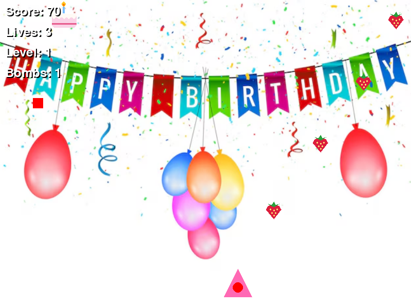

# Strawberry Shooter: Birthday Edition

[](https://github.com/Imnasir-X/strawberry-shooter-game/actions/workflows/ci.yml)
[](https://www.python.org/)
[](https://www.pygame.org/)
[](LICENSE)

A small pygame arcade shooter: fire strawberries at falling birthday cakes, chain combos, grab power-ups and take down the boss.



*Frame captured headlessly by `scripts/render_preview.py`.*

## Features

- Arcade loop with a title menu, pause screen and game-over screen with restart.
- Waves of falling cakes that speed up as your score climbs.
- Combo scoring: every five consecutive hits raises the points per kill, up to 5x.
- Power-ups dropped by defeated enemies:
  - **Yellow - Shield** for 10 seconds
  - **Purple - Triple shot** (three-way spread) for 10 seconds
  - **Red - Extra bomb**
- Bombs clear every enemy on screen and damage the boss.
- A boss with a health bar appears every few hundred points; beating it raises the level.
- Particle effects, floating score text and sound effects.
- All sprites are drawn in code, so the game runs with no image files; drop your own art into `assets/` to reskin it.

## Tech stack

- Python 3.9+
- [pygame](https://www.pygame.org/) 2.6 for rendering, input and audio

## Quick start

```bash
git clone https://github.com/Imnasir-X/strawberry-shooter-game.git
cd strawberry-shooter-game
python -m venv .venv
source .venv/bin/activate        # Windows: .venv\Scripts\activate
pip install -r requirements.txt
python shooter_game.py
```

Set `STRAWBERRY_DEBUG=1` to print asset-loading and gameplay debug messages.

## Controls

| Key            | Action                       |
|----------------|------------------------------|
| `Enter`        | Start from the menu          |
| `Left / Right` | Move                         |
| `Space`        | Shoot                        |
| `B`            | Use a bomb                   |
| `P`            | Pause / resume               |
| `Esc`          | Back to menu (paused) or quit (menu) |
| `R` / `Q`      | Restart / menu after game over |

## Custom art

Optional files in `assets/` replace the built-in sprites:

| File                     | Used for                            |
|--------------------------|-------------------------------------|
| `player.png` / `.jpg`    | Player (scaled to 60 px wide)       |
| `enemy.png` / `.jpg`     | Enemies and boss                    |
| `strawberry.png`         | Projectile (scaled to 40 px wide)   |
| `strawberry_sheet.png`   | Animated projectile, 4 frames of 50x50 |

## Development

```bash
pip install -r requirements-dev.txt
ruff check .
pytest -q                                   # headless, no display or audio needed
SDL_VIDEODRIVER=dummy python scripts/render_preview.py   # regenerates docs/preview.png
```

## Project structure

```
strawberry-shooter-game/
├── shooter_game.py         # The whole game: sprites, menus, game loop
├── assets/
│   ├── background.png      # Birthday backdrop
│   ├── shoot.wav           # Shot sound
│   ├── hit.wav             # Player-hit sound
│   └── enemy_die.wav       # Enemy-destroyed sound
├── scripts/
│   └── render_preview.py   # Headless autoplay that saves docs/preview.png
├── tests/                  # Headless smoke tests (pytest)
├── requirements.txt
└── requirements-dev.txt
```

## License

Code is released under the [MIT License](LICENSE). Copyright (c) 2026 Nasir Khan.
